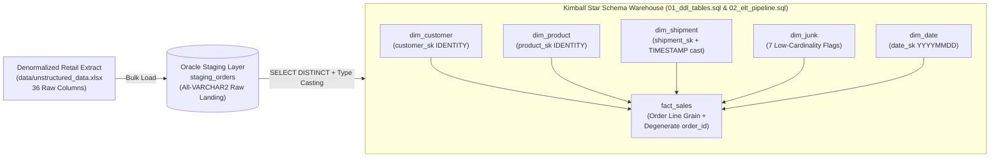
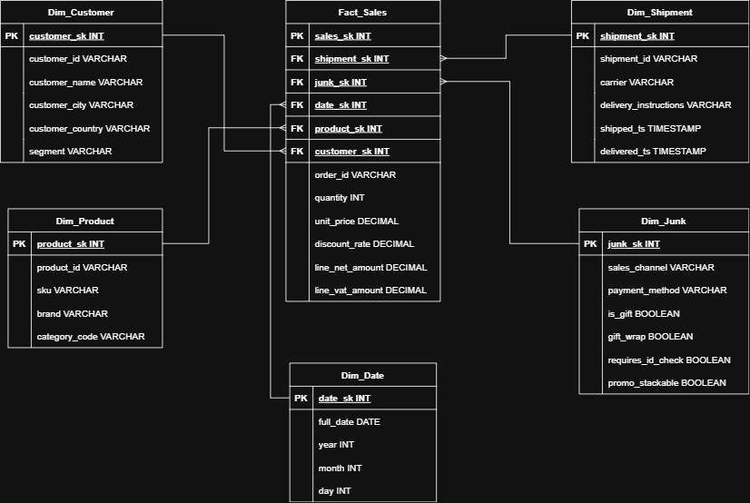

# Enterprise E-Commerce Data Warehouse & ELT Pipeline (Oracle SQL)


An enterprise-grade **Extract-Load-Transform (ELT)** pipeline engineered in **Oracle SQL** that ingests denormalized, unstructured e-commerce order extracts (36 raw attributes) into a staging table (`staging_orders`) and transforms them into a normalized **Kimball Star Schema Data Warehouse** featuring identity surrogate keys, a consolidated **Junk Dimension**, and `NVL`-safe multi-attribute fact lookups.

---

## ELT Pipeline Architecture



---

## Dimensional Model & ERD



### Key Dimensional Modeling Decisions

| Table | Role | Grain & Engineering Design |
| :--- | :--- | :--- |
| **`staging_orders`** | Staging | Raw `VARCHAR2` landing table capturing all 36 denormalized columns without ingestion failures. |
| **`dim_customer`** | Dimension | Deduplicated customer master (`customer_id`, `customer_name`, `customer_city`, `customer_country`, `segment`) with `GENERATED BY DEFAULT ON NULL AS IDENTITY` surrogate key (`customer_sk`). |
| **`dim_product`** | Dimension | Distinct catalog items (`product_id`, `sku`, `brand`, `category_code`) keyed by `product_sk`. |
| **`dim_shipment`** | Dimension | Logistics fulfillment metadata (`shipment_id`, `carrier`, `delivery_instructions`) with string timestamps parsed via `TO_TIMESTAMP(..., 'YYYY-MM-DD HH24:MI:SS')`. |
| **`dim_junk`** | Junk Dimension | Consolidates 7 low-cardinality indicators and flags (`sales_channel`, `payment_method`, `device_type`, `is_gift`, `gift_wrap`, `requires_id_check`, `promo_stackable`) into a single Cartesian-free dimension (`junk_sk`). |
| **`dim_date`** | Date Dimension | Integer smart key (`YYYYMMDD` via `TO_NUMBER(REPLACE(order_date, '-', ''))`) with parsed `full_date`, `year`, `month`, and `day_name`. |
| **`fact_sales`** | Fact Table | **Order Line grain** (`order_id` degenerate dimension + `line_nbr`), linked to all 5 dimension surrogate keys and storing cast numeric measures (`quantity`, `unit_price`, `discount_rate`, `line_net_amount`, `line_vat_amount`). |

### Null-Safe Junk Dimension Lookup (`02_elt_pipeline.sql`)
Because optional flags in `staging_orders` can contain `NULL` values, standard equality joins would drop valid fact rows. The ELT pipeline enforces `NVL`-wrapped composite joins during fact population:
```sql
JOIN dim_junk j ON 
    NVL(s.sales_channel, 'X')     = NVL(j.sales_channel, 'X') AND
    NVL(s.payment_method, 'X')    = NVL(j.payment_method, 'X') AND
    NVL(s.device_type, 'X')       = NVL(j.device_type, 'X') AND
    NVL(s.is_gift, 'X')           = NVL(j.is_gift, 'X') AND
    NVL(s.gift_wrap, 'X')         = NVL(j.gift_wrap, 'X') AND
    NVL(s.requires_id_check, 'X') = NVL(j.requires_id_check, 'X') AND
    NVL(s.promo_stackable, 'X')   = NVL(j.promo_stackable, 'X');
```

---

## Repository Structure

```text
├── sql/
│   ├── 01_ddl_tables.sql        # Oracle DDL for staging_orders, 5 dimensions, and fact_sales
│   └── 02_elt_pipeline.sql      # Deduplication, type conversion, and surrogate-key lookup DML
├── data/
│   ├── unstructured_data.xlsx   # Raw denormalized e-commerce dataset
│   └── data_dictionary.xlsx     # Attribute definitions & business rules
└── docs/
    └── erd_diagram.png          # Physical Star Schema Entity-Relationship Diagram
```

---

## Execution Guide

1. **Create Staging & Warehouse Schema:** Execute `sql/01_ddl_tables.sql` in an Oracle Database session (DataGrip / SQL Developer / SQL*Plus).
2. **Ingest Raw Dataset:** Import `data/unstructured_data.xlsx` into `staging_orders`.
3. **Run ELT Pipeline:** Execute `sql/02_elt_pipeline.sql` to populate all dimensions (`dim_*`), resolve surrogate keys, and load `fact_sales`.
